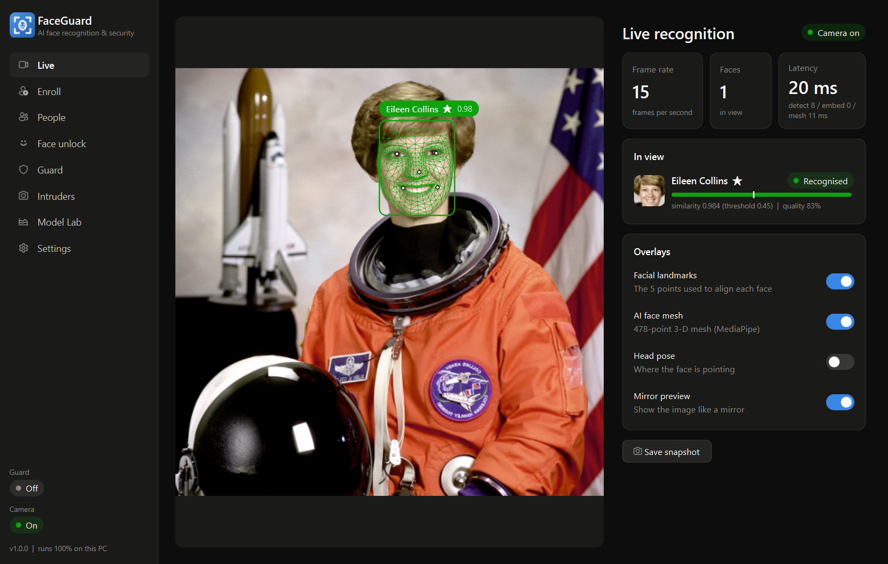
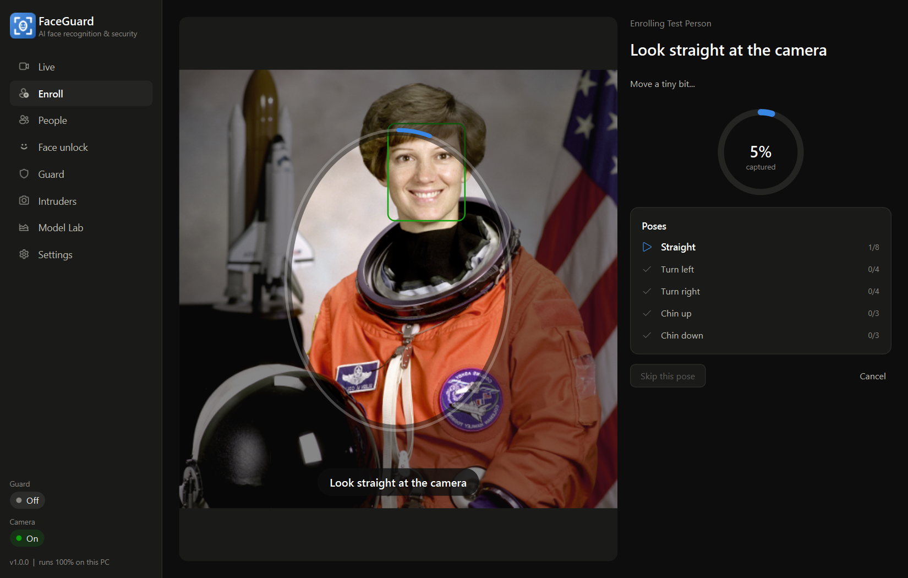
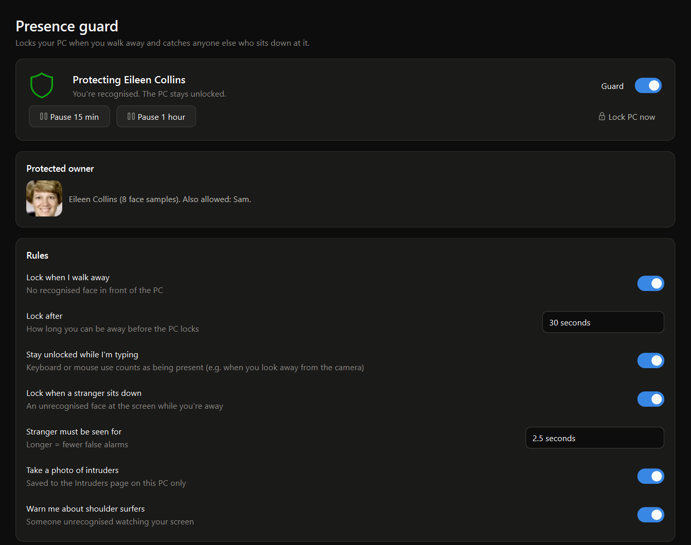
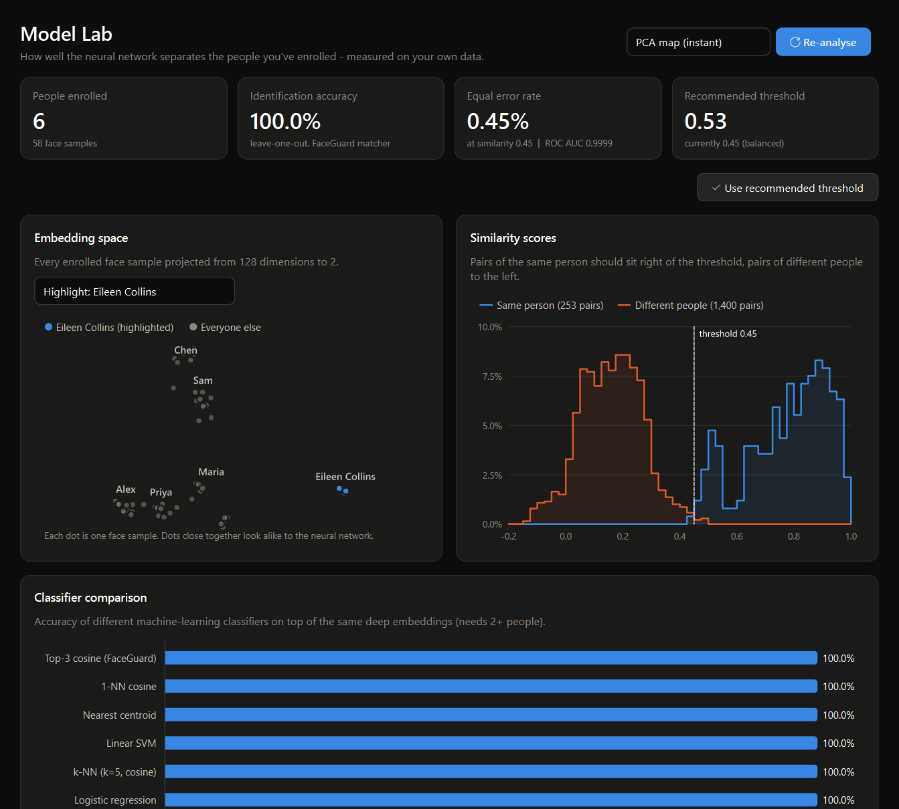
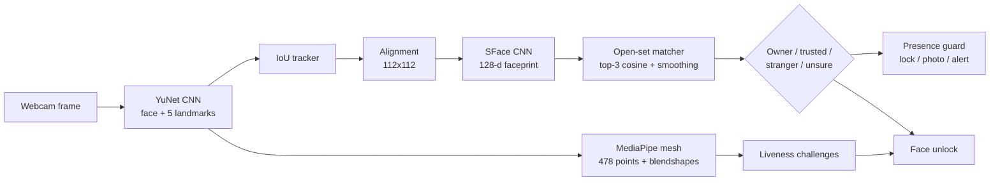

# FaceGuard

**AI face recognition, liveness detection and presence security for Windows PCs with an ordinary webcam.**

FaceGuard recognises you (and the people you enroll) in real time. It proves that a live person is present,
not a photo, and uses that to protect your PC: it locks the screen the moment you walk away, and locks it and
takes a photo if someone else sits down at it. Everything runs locally on the CPU. No cloud and no account
are needed, and your face data is encrypted with your Windows login.



---

## Why not just "Windows Hello Face"?

Windows Hello face sign-in only works with **infrared (IR) cameras**, because an IR camera can tell a real face
from a printed photo or a phone screen. Microsoft deliberately doesn't allow normal RGB webcams to unlock
Windows. Replacing the Windows sign-in with a webcam-based login would make your PC *easier* to break into.

So FaceGuard never replaces your PIN or password. It adds the protection a normal webcam *can* provide safely:

| | Windows Hello Face (IR camera) | FaceGuard (any webcam) |
|---|---|---|
| Unlock Windows with your face | Yes | No, by design (use your PIN) |
| Lock automatically when you walk away | No (only "Dynamic Lock" via a paired phone) | **Yes** |
| Lock + photograph a stranger who sits down | No | **Yes** |
| Photograph someone at your *locked* PC | No | **Yes** (lock-screen watch) |
| Warn about shoulder-surfers | Some laptops | **Yes** |
| Face recognition of several people | No | **Yes** |
| Liveness / anti-spoofing | IR depth | **Challenge-response** (head turns, blink, smile) |
| "Face unlock" for your own apps and scripts | No | **Yes** (`faceguard verify` exit code) |

If you want real face *sign-in*, a Windows Hello-certified IR webcam costs about the same as a regular one and
works alongside FaceGuard.

---

## Features

**Computer vision**
- **YuNet** CNN face detector: faces plus 5 landmarks per frame, down to about 20 px faces.
- Landmark-based **face alignment** to a canonical 112×112 pose.
- **Head-pose estimation** from 5 landmarks (calibrated against MediaPipe's 3-D pose, r = 0.91).
- **MediaPipe Face Landmarker**: a 478-point 3-D face mesh plus 52 expression blendshapes.
- **Image-quality gate**: sharpness, exposure, glare, size and pose, with thresholds calibrated on real data.
- Multi-face **IoU tracker** that keeps identities stable across frames.

**Machine learning / AI**
- **SFace** deep face-recognition network (MobileFaceNet-style, margin-based loss) that turns each face into
  a 128-number "faceprint".
- **Open-set identification**: top-k cosine matching, temporal smoothing per tracked face, and explicit
  *unknown* and *not sure* zones.
- **Guided enrollment** that captures 22 samples across 5 head poses, with duplicate and outlier rejection.
- **Adaptive (online) learning**: very confident live matches slowly update your template. It's rate-limited
  and capped so the template can't drift to someone else.
- **Model Lab**: leave-one-out accuracy for 6 classifiers (FaceGuard top-3, 1-NN, nearest centroid, linear SVM,
  k-NN, logistic regression); genuine vs impostor score distributions; ROC AUC; equal error rate; a data-driven
  threshold recommendation; and PCA / t-SNE maps of the embedding space.
- **Benchmark tool** for your own labelled folders, the AT&T/Olivetti faces or LFW (standard 10-fold protocol).

**Security**
- **Liveness detection** from a random sequence of actions (turn left or right, blink, smile). A flat photo
  can't turn its head (see [How liveness works](#how-liveness-works)).
- **Presence guard**:
  - walk-away auto-lock that doesn't lock while you're typing;
  - intruder lock plus a photo;
  - shoulder-surfer alerts;
  - grace period after unlocking and rate-limiting, so a recognition problem can never lock you out in a loop.
- **Encrypted face database** (Windows DPAPI). It can only be read by your Windows account on this PC. Writes
  are atomic, with an automatic backup.
- **No photos of you are stored**: only the faceprints and 3 small thumbnails.

**App**
- **Desktop app** (PySide6) with a dark UI, a live view with overlays, an enrollment wizard, a face-unlock
  screen, people management, guard controls, an intruder gallery, Model Lab and settings.
- **System-tray mode** with notifications, and optional **start with Windows**.
- **Scriptable CLI** for every feature.

| Enrollment wizard | Face unlock (liveness) |
|---|---|
|  |  |

| Presence guard | Model Lab |
|---|---|
|  |  |

---

## Quick start

1. Double-click **`FaceGuard.bat`**. On a fresh copy it runs `setup.bat` first, which creates a Python
   environment, installs the packages and downloads the 3 models (about 43 MB).
2. **Enroll**: type your name, keep *"This is the owner of this PC"* ticked, and press **Start camera
   enrollment**. Follow the prompts (look straight, turn left, turn right, chin up, chin down), which takes
   about 20 seconds.
3. **Live**: you should now see your name above your face. Try the *AI face mesh* toggle.
4. **Face unlock**: press *Start verification* and follow the 3 random actions.
5. **Guard**: switch it on. Walk away and the PC locks after 30 s. When someone else sits down, it locks and
   saves their photo under *Intruders*. Unlock as usual with your Windows PIN or password.
6. Optional: enable *Start with Windows* on the Guard page, and run `create_shortcut.bat` for a desktop icon.

> Tip: good light in front of you, not behind you, matters more than anything else for accuracy.

---

## How it works



### Models

| Model | Architecture | Output | Size | Source / licence |
|---|---|---|---|---|
| `face_detection_yunet_2023mar.onnx` | YuNet (light-weight anchor-free CNN) | box, 5 landmarks, score | 0.2 MB | OpenCV Model Zoo, MIT |
| `face_recognition_sface_2021dec.onnx` | SFace (MobileFaceNet-style, sigmoid-constrained hypersphere loss) | 128-d embedding | 38.7 MB | OpenCV Model Zoo, Apache-2.0 |
| `face_landmarker.task` | MediaPipe BlazeFace + face mesh + blendshape nets | 478 3-D points, 52 blendshapes, head pose | 3.8 MB | Google MediaPipe, Apache-2.0 |

All three are downloaded from their official publishers and **verified against pinned SHA-256 hashes**
(`faceguard/models.py`).

### Matching (open-set identification)

Every enrolled sample *s* and a new face *q* are unit vectors, so similarity is the cosine *q·s*. For each
person FaceGuard takes the **mean of the 3 highest similarities** to that person's samples. This uses the
samples whose pose matches the query and is more robust than one centroid or one nearest neighbour. Scores
are then **smoothed over time** per tracked face with an exponential moving average. The decision is:

* score ≥ **threshold** (0.38 relaxed / **0.45 balanced** / 0.52 strict) → **match**
* score < **0.30** → **unknown**: confidently not enrolled, and only this can trigger the guard
* in between → **not sure**: never used to unlock anything or raise an alarm

### How liveness works

A head turn must pass **two** geometric tests:

1. **Yaw ratio.** The nose position relative to the eyes must change by at least 18°.
2. **Homography parallax.** Eyes and mouth corners are nearly coplanar. The four of them define a plane
   transformation (homography) between the "look straight" frame and the current frame. On anything flat (a
   print or a phone screen, however it's tilted or moved) the nose must follow that same transformation
   exactly, so the parallax is **mathematically zero**. On a real head the nose sticks out ~37 mm and moves
   off the prediction.

Test 1 alone can be fooled by a print tilted steeply towards the camera, because perspective tilts the eye line
and the roll correction leaks the nose's vertical offset into apparent yaw. Test 2 closes that gap. This was
found and quantified in `experiments/exp_parallax.py`.

Blink and smile use MediaPipe blendshape scores, which a still image can't change. The sequence of actions is
random and time-limited, and **out-of-order actions are strikes**: turning the wrong way, turning during a
blink/smile prompt, or smiling during another prompt. One strike is forgiven, the second fails the check. This
defeats "universal" replay videos that cycle through every action. An embedding-consistency check ensures the
same face stays in view the whole time.

### Presence guard rules

* **Walk-away lock**: no owner or trusted face for *N* seconds **and** no keyboard or mouse input for that long.
  A warning comes 8 s before the lock.
* **Intruder**: a face that is confidently *unknown* (or enrolled but not trusted), close to the screen and
  sharp, is seen for 2.5 s while you're away. FaceGuard then saves a photo, shows a notification and locks.
* **Shoulder surfer**: you're present and an unrecognised face watches for 3 s. FaceGuard shows a notification.
* **Lock-screen watch**: for a chosen time after the PC locks (default 30 min), anyone unrecognised who sits
  down at the locked PC is photographed. For example, someone trying to guess your PIN.
* **Safety valves**: a 15 s grace period after each unlock, at most 3 intruder locks per 10 minutes, and a
  camera failure never causes a lock. The camera is released while the PC is locked, once the lock-screen watch
  window has ended.

---

## Measured results

Measured on this project's development PC (AMD Ryzen 7 7730U, CPU only, no GPU).

| Stage | Time |
|---|---|
| Face detection (YuNet, 640×480) | ~11 ms |
| Alignment + faceprint (SFace) | ~9 ms per face |
| Face mesh (MediaPipe, video mode) | ~10 ms |
| **Whole pipeline** | **~20–35 ms per frame**, i.e. real time (webcams deliver ≤ 30 FPS); the guard checks 4×/s in the background |

**Accuracy on the AT&T / Olivetti face set** (40 people × 10 photos, `python -m faceguard benchmark --olivetti`):

| Metric | Result |
|---|---|
| Rank-1 identification (5-fold) | **100 %** |
| Verification ROC AUC | **0.9998** |
| Equal error rate | **0.66 %** |
| True-accept rate at 1 % false-accept rate | 99.6 % |
| True-accept rate at 0.1 % false-accept rate | 97.4 % |

Olivetti photos are tiny 64×64 grayscale images, which is harder than a webcam: different people score higher
against each other there. That's exactly why **Model Lab** measures *your* enrolled people and recommends a
threshold for them. You can run the standard LFW benchmark yourself with `benchmark --lfw` (230 MB download).

**Calibration experiments** (these set the quality gate): SFace similarity stays high in dim light (0.92 at
25 % brightness) but collapses with over-exposure (0.50). It survives mild blur but drops below a sharpness of
about 30, and needs faces at least ~40 px wide.

## Research paper and reproducibility

The accompanying paper, *FaceGuard: Continuous Face Authentication With a Homography-Parallax Liveness Cue
for Commodity Webcams*, is in [`paper/`](paper/) (LaTeX source `faceguard.tex`, PDF, figures and the generated
result tables).
Every number in it is produced by the scripts in [`experiments/`](experiments/): results are written to
`experiments/results/*.json` and `experiments/make_figures.py` turns them into the paper's figures and
number macros. [`experiments/README.md`](experiments/README.md) lists each script, the datasets to download
(LFW, MPIIFaceGaze, LFW attribute labels, InsightFace models - not redistributed here because of their
licences) and the order in which to run them. Random seeds are fixed in the scripts.

The real-world pilot is summarised in `experiments/results/realworld.json`; the raw per-frame logs are not
published because they contain a participant's face landmarks.

---

## Command line

```bash
python -m faceguard                       # desktop app (same as FaceGuard.bat)
python -m faceguard tray                  # start in the tray with the guard on (used at sign-in)
python -m faceguard doctor [--camera]     # check the installation (and optionally the webcam)
python -m faceguard enroll "Alex" [--images photos/] [--owner]
python -m faceguard recognize [--image a.jpg b.jpg --save out/] [--mesh]
python -m faceguard verify [--owner]      # liveness + face check; exit code 0 = verified
python -m faceguard people list|rename|delete|owner|trust|untrust|reset-adaptive NAME [NEW]
python -m faceguard analyze [--tsne]      # Model Lab in the terminal
python -m faceguard benchmark --olivetti | --lfw | --folder DATASET [--out reports/]
python -m faceguard guard                 # presence guard in a console window
python -m faceguard download-models
```

(Use `.venv\Scripts\python.exe` instead of `python` if the environment isn't activated.)

`verify` makes face unlock available to your own scripts, for example:
`python -m faceguard verify --owner && start "" "C:\Secret\notes.txt"`.

---

## Privacy & security notes

* **Stored**: the 128-number faceprints, 3 small face thumbnails per person, settings, logs and intruder photos,
  all in `%LOCALAPPDATA%\FaceGuard`. The face database is DPAPI-encrypted.
* **Never stored**: video, or photos of you. Nothing is ever uploaded; the only network use is the one-time
  model download.
* **Limitations** (please read):
  * A face check with an RGB webcam can be fooled by a determined attacker with a realistic mask, a live
    deepfake or identical twins. That's why FaceGuard **adds** protection on top of your PIN or password and
    never replaces it.
  * Walk-away locking can fire if you lean far back or read without touching the keyboard. Raise the timeout
    or keep "Stay unlocked while I'm typing" on.
  * While the guard is on it uses the webcam, so video calls may not get the camera on some PCs. Use
    *Pause* (tray menu) during calls.

---

## Project structure

```
FaceGuard/
├─ FaceGuard.bat / setup.bat / create_shortcut.bat
├─ faceguard/
│  ├─ cli.py              command-line interface
│  ├─ config.py           settings (JSON)       models.py  model download + SHA-256 check
│  ├─ vision/             detector.py  embedder.py  mesh.py  geometry.py  quality.py  camera.py  drawing.py
│  ├─ recognition/        gallery.py (matcher)  database.py (encrypted)  tracker.py  engine.py
│  │                      enrollment.py  adaptive.py  analysis.py (Model Lab)  evaluation.py (benchmarks)
│  ├─ security/           liveness.py  guard.py  runner.py  intruders.py  dpapi.py  winsys.py
│  └─ gui/                app.py  main_window.py  worker.py (camera/AI thread)  widgets.py  charts.py  pages/
├─ tests/                 85 automated tests
└─ models/                the 3 neural networks
```

## Tests

```bash
.venv\Scripts\python.exe -m pytest -q
```

The 85 tests cover:

- **Geometry:** head-pose sign conventions, and that a squeezed photo keeps yaw ≈ 0.
- **Matcher and database:** encryption round trip and damaged-file recovery.
- **Tracker, enrollment and liveness:** simulated live users, printed-photo attacks, face swaps, extra
  people, lost faces.
- **Guard:** every rule, including the lock-out safety valves.
- **Metrics and pipeline:** the real models on a public-domain NASA portrait.
- **GUI:** a smoke test of the whole app.

## Troubleshooting

| Problem | Fix |
|---|---|
| "Camera unavailable" | Close other camera apps (Teams, Zoom, Camera). Allow desktop apps in **Settings → Privacy & security → Camera**. |
| Not recognised reliably | Re-enroll facing a window or lamp; use *Add samples* on the People page; check Model Lab. |
| PC locks while you're there | Raise *Lock after*, keep *Stay unlocked while I'm typing* on, improve lighting. |
| Wrong camera | Settings → Camera → *Detect cameras*. |

## Credits

YuNet and SFace: OpenCV Model Zoo. Face mesh: Google MediaPipe. UI: Qt / PySide6. ML metrics: scikit-learn.
The test photo is NASA's public-domain portrait of astronaut Eileen Collins.

## License

The FaceGuard code is released under the [MIT License](LICENSE). The pretrained models and datasets it
downloads are not part of this repository and keep their own licences (see the end of `LICENSE`).
